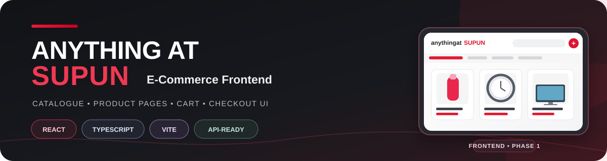

<p align="center">
  
</p>

<p align="center"><b>Modern shopping • smooth browsing • responsive storefront</b></p>

<p align="center">
  
  
  
</p>

## About

**Anything at Supun** is a modern React storefront redesign for Supun Group of Companies, with a clean red-and-white shopping experience.

**Frontend includes:** Home and banner carousels, shop and categories, product details, filters, search, cart, wishlist, checkout UI and customer account UI.

## Tech Stack

`React` · `TypeScript` · `Vite` · `CSS`

## Run Locally

```bash
npm ci
npm run dev
npm run build
```

## Integration Status

**Frontend prototype — WordPress/WooCommerce API integration pending.** Product data is currently local; real accounts, admin updates, orders and payments are not connected.

📄 [Backend API Handover](docs/API-INTEGRATION-HANDOVER.md) · 🌐 [Existing Live Store](https://anythingatsupun.lk/)

---

<p align="center"><b>Discover • Shop • Checkout</b></p>
